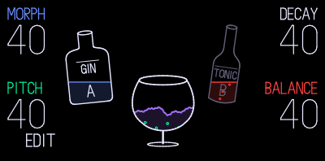
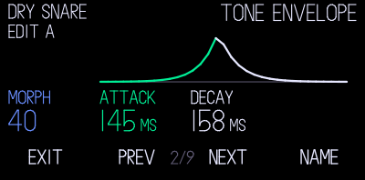
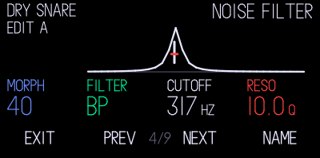
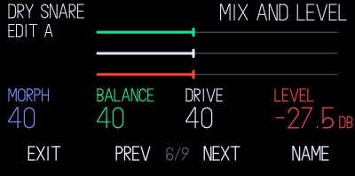
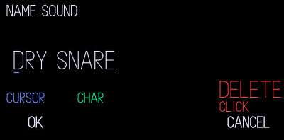
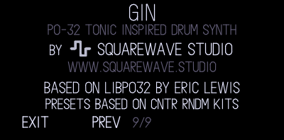

# GIN

Designing your own instrument screen? See the [OP-1 Design Kit](https://github.com/squarewave-studio/op1-design-kit) for the shared UI guidance.

Synth drums on all 24 keys of the original OP-1, by [SquareWave Studio](https://squarewave.studio).

GIN is a drum synth based on the PO-32 Tonic's drum engine, built on Eric
Lewis's [libpo32](https://github.com/ericlewis/libpo32). Every key is its own
sound, synthesised rather than sampled, so you can bend a kick or a hat into
something new without ever loading a file.

## Play It

Each key has two versions of its sound, A and B. The blue encoder morphs
between them, so you can push a snare from dry to splashy while a pattern
runs. Click blue to choose which side you're editing.

| Encoder | Turn | Shift + Turn |
| --- | --- | --- |
| Blue | Morph, A to B | Morph, A to B |
| Green | Tone pitch | Pitch modulation amount |
| White | Tone decay | Noise decay |
| Orange | Tone and noise balance | Noise filter cutoff |

Four voices play at once, with retriggering and voice stealing.

## Go Deeper

The engine has a lot more in it than four encoders can show. Press T1 for
eight Advanced pages covering all 21 parameters: tone, tone envelope, pitch
mod, noise filter, noise envelope, mix and level, EQ and velocity. The pages
draw the waves, envelopes and filter, so you can see what you're changing.

You can name every sound, up to 23 characters. Edits save to the working slot
and are still there after a restart. Hold one of the 1 to 8 snapshot buttons to keep a
separate named version of the whole kit.

## Eight Kits To Start With

GIN comes with eight factory kits adapted from
[CNTR RNDM's free PO-32 kits](https://youtube.com/playlist?list=PLlkIAiu0_jPw3DgmZm1RbmFe86rzuWU2o).
Each one fills all 24 keys. The original sounds are his. I've laid them out
across the keyboard and added variations.

## Screens

Rendered from the screen code with the original OP-1 font, matching the build
tested on hardware. They aren't photos of the hardware, emulator captures or
proof of OP1P loader support. Extracted font data isn't distributed here.

### Tone Envelope

### Noise Filter

### Mix And Level

### Name A Sound

### About

## Version 1.0.0

GIN 1.0.0 is a source release for community firmware builders. The
standalone build is tested on the original OP-1 with firmware #246.
[Get the core, native source and build instructions](docs/BUILDERS.md).
There's no loadable `gin.op1p` yet.

GIN keeps to four voices. Very dense patterns can still break up when a lot
else on the OP-1 is running at the same time.

[Controls And Saving](docs/CONTROLS.md) · [Compatibility](docs/COMPATIBILITY.md) · [Release Notes](CHANGELOG.md)

## Coming To op1r As A Plugin

The standalone build and the plugin are different packages. op1r's current
drum path is built for the sample-based Drum+ engine, so a separate drum
synth like GIN needs new shared host support in op1r. I'm working on that
next.

The plugin will keep the same sound, editor and saved state. `gin.op1p` will
be offered once it passes its own loader, switching, saving and
missing-plugin recovery tests. Installing a different firmware doesn't mean
GIN will run on it. Each release will list the host versions it was tested
with.

## Credits

GIN is by SquareWave Studio. The synthesis core derives from Eric Lewis's
MIT-licensed [libpo32](https://github.com/ericlewis/libpo32).
Factory sounds adapt eight of [CNTR RNDM's free PO-32 kits](https://youtube.com/playlist?list=PLlkIAiu0_jPw3DgmZm1RbmFe86rzuWU2o).
The original sounds are CNTR RNDM's; GIN adds the 24-key layout and variations.
op1r is by pcppcp and contributors. See [component and licence notes](../../THIRD_PARTY.md).

GIN is not affiliated with, authorised by, sponsored by or endorsed by Teenage
Engineering AB or Sonic Charge / NuEdge Development AB. All trademarks remain
their owners' property. [Ownership and source-publication notes](../../THIRD_PARTY.md#independence-and-trademarks).

## Support My Open Source Work

GIN is free. If it's been useful, you can leave a thank-you tip. It doesn't
unlock anything. It just helps me keep building mods like this.

- [Buy me a coffee ($5)](https://buy.squarewave.studio/checkout/buy/880667af-df68-45e1-b8e5-e36c2b5de26e)
- [Buy me lunch ($10)](https://buy.squarewave.studio/checkout/buy/eeb321a3-dea8-486d-9ef7-0794584feb9c)
- [Buy me dinner ($20)](https://buy.squarewave.studio/checkout/buy/edba5162-42c0-4c27-bc95-f41096c2451d)
- [Choose your own amount](https://buy.squarewave.studio/checkout/buy/59446300-c1a9-43d5-90ce-6b4c9f4252c7) (from $3)
