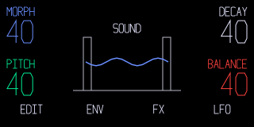

# OP-1 UI

A draft design kit for the **original OP-1**, made by SquareWave Studio.
Build legible synth, drum, effect and utility screens with three text roles and
four visible encoder lanes. The guidance is voluntary, versioned and open to
contributions. Version **0.1.0 is a draft**, not a TE specification.



*Original reference artwork and schematic alphabet. Stock typography unverified
in this public image. Load a local stock font for typography review.*

## Start Here

- [Design](docs/DESIGN.md): hierarchy, Small/Medium/Large, colours and margins.
- [Fonts](docs/FONTS.md): where to get `opfont.svg`, stock IDs, glyph checks and host loading.
- [Graphics](docs/GRAPHICS.md): restricted SVG, named blocks, smooth edges and CPU cost.
- [Components](docs/COMPONENTS.md): APIs, layouts and runtime binding contracts.
- [Sources](docs/SOURCES.md): public references, pins, evidence and open questions.
- [Agent Skill](../skills/op1-design/SKILL.md): portable, self-contained instructions.

## Read The Kit

Start with the Spec, Font and Graphics guidance above. The Pages site presents
static component renders and the same rules as the portable skill. You do not
need a stock font to read or use the design guidance.

An optional local workbench is included for component developers:

```sh
python3 op1-ui/tools/preview.py
# Open http://127.0.0.1:8765/op1-ui/workbench.html
```

It starts in labelled schematic-font mode. If you need faithful typography,
choose your own `opfont.svg` with the file picker. The browser reads it on your
machine and uploads nothing. The kit does not serve TE assets.

The workbench's Play, Edit and Browse layouts demonstrate components and states.
They are not a synth or tape backend. The main Pages site is static guidance.

## Use A Component

```js
import { scene, parameter, softKeys, renderSvg, validateScene } from './op1-ui/src/components.mjs';
const screen = scene();
parameter(screen, {
  id: 'attack', label: 'ATTACK', value: '145', unit: 'MS',
  lane: 1, x: 89, y: 88, size: 'medium'
});
softKeys(screen, ['EXIT', 'PREV', 'NEXT', 'NAME']);
console.log(validateScene(screen));
console.log(renderSvg(screen)); // Original schematic font only.
```

The JS implementation is a reference renderer. Use the same role names, control
maps and [JSON tokens](tokens/op1-ui.json) in Python, C or another host stack.
[C constants](include/op1_ui_tokens.h) have no SDK or firmware dependency. Native
font constructors and Q10 helpers need explicit framework adapters; a browser
font size is not a native text-constructor argument.

## Install The Skill

Install the skill in your firmware project:

```sh
npx skills add squarewave-studio/op1-mods
```

Select **op1-design**. Or copy the whole `skills/op1-design` folder into your
tool's skills directory. It follows the [Agent Skills format](https://agentskills.io/specification)
and includes its references and local font inspector. Ask it to design an
original OP-1 screen with your local stock font and Small/Medium/Large text.

[`SKILL.md`](../skills/op1-design/SKILL.md) is the source for the
[Spec](docs/DESIGN.md), [`design-kit.json`](../design-kit.json) and code constants.

## Build The Site

The site uses the repo's default GitHub Pages path. Build a static preview with
Python and the pinned Markdown renderer:

```sh
python3 -m pip install Markdown==3.7
python3 op1-ui/tools/build_site.py
python3 op1-ui/tools/check_site.py
python3 op1-ui/tools/preview.py
# Open http://127.0.0.1:8765/out/pages/
```

The Pages Action builds from `main`. Deployment is enabled by the repository
variable `ENABLE_DESIGN_KIT_PAGES=true` with Pages configured for GitHub Actions.
The build has no private asset input. No analytics, cookies or trackers are included.

## Check Changes

```sh
python3 op1-ui/tools/sync_tokens.py --check
python3 op1-ui/tools/sync_skill.py --check
node --test op1-ui/tests/*.test.mjs
python3 -m unittest discover -s op1-ui/tests
node op1-ui/tools/export_examples.mjs
python3 op1-ui/tools/check_svg.py op1-ui/examples/*.svg
```

The SVG checker is deliberately conservative. Passing it does not qualify a
native parser, heap, screen binding, physical display or audio deadline. Public
path-text examples favour inspectability and exceed the suggested 8 KiB artwork
budget; native integrations should use their supported text service and measure
the resulting cost. No native speedup is claimed.

## Licence And Attribution

Original code, guidance, schematic alphabet and reference drawings are covered
by the repository's [MIT licence](../LICENSE). [Contributing](../CONTRIBUTING.md)
is welcome. [Third-party notices](../THIRD_PARTY.md) distinguish source references
from dependencies. No TE firmware, source code, stock font, font atlas, extracted
glyph geometry or stock screen artwork is distributed in this kit. OP-1 and
Teenage Engineering are their owners' trademarks; this is independent community work.
