# Screen Examples

Original compositions informed by stock #246 screen families, rendered from code with schematic lettering. These are not stock screens or hardware captures. Every example uses the proposed three text roles and encoder colours. No font loading is needed.

See [Stock Screen Patterns](STOCK.md) for the inspected resource families, palette identity and evidence limits.

## Synth Relationships

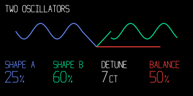

Two sources meet at one output. Colour identifies ownership without copying an engine illustration.

## Envelope Stages

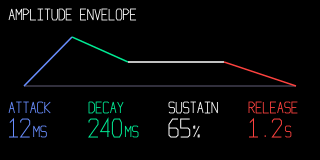

Four coloured stages and four stable readout columns. Units share the value baseline.

## Sample Boundaries

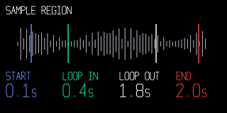

Cached peaks, four distinct boundaries and a small live cursor layer. Recompute peaks when sample data changes.

## Drum Selection

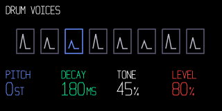

Selection uses an outline and position as well as colour. Keep pad geometry fixed when selecting a voice.

## Effect Relationships

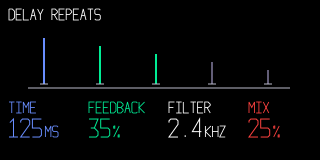

Repeat height explains feedback. Store the stable guide and update only the changing repeat representation.

## Modulation Routing

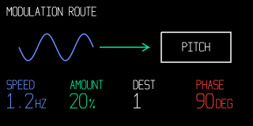

Source, depth and destination form a readable route. The host example is a static snapshot.

## Step And Play Position

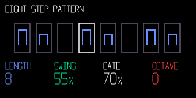

Notes use Blue; the white frame identifies the play position separately. Update only affected steps.

## Tape Position

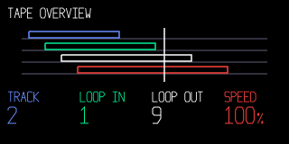

Four lanes and a playhead communicate time without reel animation. The ruler and clips can be retained geometry.

## Four Control Lanes

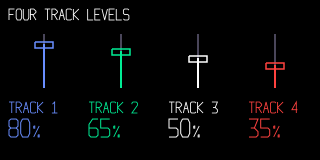

The physical encoder order is repeated in colour, position and track labels. Meter and fader state have separate jobs.

## Frequency Regions

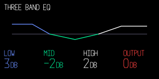

Three bands meet at a shared neutral line. Rebuild the response only when relevant controls change.

## Dynamics Feedback

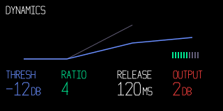

A stable transfer diagram and a small meter layer keep configuration and live activity distinct.

## One Dominant Value

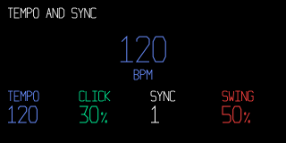

Large tempo with Small units and Medium supporting values. The duplicate control value demonstrates its encoder mapping.

## Input And Level

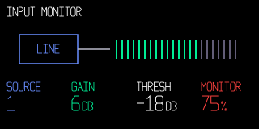

A labelled source feeds a segmented meter. Dim segments are decoration; the source and gain stay readable.

## Recording State

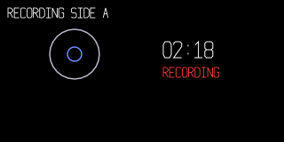

Elapsed time and the word RECORDING carry the state. Colour alone is insufficient. No decorative rotation is needed.
